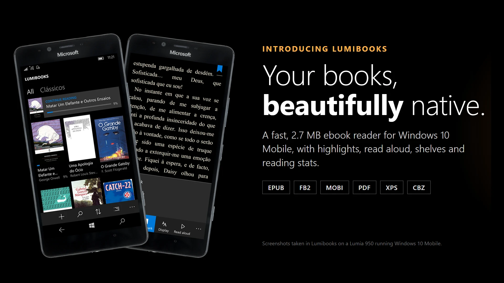

# Lumibooks



A light, native eBook reader for Windows 10 Mobile, written in C++/CX.

- Targets Windows 10 Mobile 15063 (Lumia 950) and desktop x86
- EPUB, FB2 and MOBI in a reflowing reader; PDF, XPS and CBZ rendered with MuPDF
- Library with favourites and shelves
- Read aloud using the system voices, with sentence highlighting and lock-screen controls
- Fonts, size, weight, letter and line spacing, margins, paragraph spacing, indent, hyphenation
- Day, sepia, night, black and custom color themes, plus a night light filter
- Highlights in four colors, notes, bookmarks and a table of contents

## Building

You'll need Visual Studio 2019 with the UWP workload, the C++ UWP ARM tools and the Windows 10 SDK 19041.

```powershell
powershell -ExecutionPolicy Bypass -File Lumibooks\build.ps1
```

This builds a Release|ARM `.appx` (no bundle) into `Lumibooks\out` and bumps the package version first. The first run creates a `CN=lumiaw10m` signing certificate (`Lumibooks.pfx`, git-ignored, and `Lumibooks.cer`). Add `-Install` to install the package on the phone through Device Portal:

```powershell
$env:LUMIA_IP = '192.168.1.50'
powershell -ExecutionPolicy Bypass -File Lumibooks\build.ps1 -Install
```

Use `-Platform x86` for a desktop build, or open `Lumibooks.sln` in Visual Studio to debug.

## Third-party

- [miniz](https://github.com/richgel999/miniz) (MIT)
- [MuPDF](https://mupdf.com) 1.28.6 (AGPL-3.0), built without its HTML engine, JavaScript, OCR and extra fonts, with FreeType, jbig2dec, libjpeg, OpenJPEG and zlib

## License

Lumibooks is licensed under the GNU Affero General Public License v3.0, the same license as MuPDF. See [LICENSE](LICENSE).
